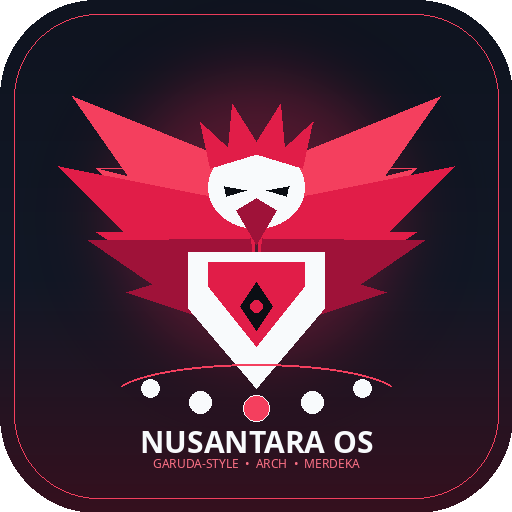

# Nusantara OS

**Distro Linux berbasis Arch — ala Garuda OS.** KDE Plasma, BTRFS + snapshot, installer Calamares, dan tuning gaming.

<p align="center">
  
</p>

<p align="center">
  <a href="../../actions/workflows/build-iso.yml"></a>
  
  
  
  
  
</p>

> Bukan produk resmi Garuda Linux dan tidak berafiliasi dengannya.

---

## Fitur

| Fitur | Detail |
|---|---|
| Basis | Arch Linux rolling release |
| Kernel | `linux-zen` (+ opsi `linux-lts`, `linux-cachyos`) |
| Desktop | KDE Plasma (`plasma-meta`), SDDM; varian Xfce / GNOME / Sway |
| Filesystem | BTRFS subvolume `@`, `@home`, `@snapshots`, `@var_log`, `@var_cache` |
| Snapshot | Snapper + Timeshift + `grub-btrfs` (boot ke snapshot) |
| Installer | Calamares 3.3 — grafis, partisi BTRFS otomatis |
| Gaming | Steam, Lutris, GameMode, MangoHud, RetroArch, Winetricks |
| Grafis | Mesa + Vulkan (AMD/Intel), driver NVIDIA di `nusantara-assistant` |
| Audio | PipeWire + WirePlumber |
| Jaringan | NetworkManager, BlueZ, firewall KDE |
| Performa | `earlyoom`, `tuned`, `power-profiles-daemon`, `thermald` |
| Tema | Merah-putih: SDDM `nusantara`, Plymouth, GRUB, logo Garuda |
| Tool | `nusantara-assistant`, `nusantara-update`, `nusantara-settings` |

## Build ISO

### Otomatis (GitHub Actions)

Workflow [`.github/workflows/build-iso.yml`](.github/workflows/build-iso.yml) membangun ISO di container `archlinux:latest` setiap push ke `main`, dan mengunggahnya sebagai artefak.

- **Actions → build-iso → Run workflow** untuk build manual (pilih profil `kde`/`xfce`/`gnome`/`sway`)
- Setiap release baru otomatis melampirkan ISO ke halaman release
- Unduh hasil: tab **Actions** → run terakhir → **Artifacts → NusantaraOS-iso**

### Manual (di Arch / Garuda / CachyOS)

```bash
sudo pacman -Syu --needed archiso squashfs-tools base-devel git zstd
git clone https://github.com/antonocik/nusantara-os && cd nusantara-os

sudo ./build.sh kde          # atau: xfce | gnome | sway
ls -lh out/*.iso             # NusantaraOS-<tanggal>-x86_64.iso
```

Variabel lingkungan yang berguna:

```bash
CLEAN=1 sudo ./build.sh kde        # hapus work/ + out/ dulu
SKIP_PKG_CHECK=1 sudo ./build.sh   # lewati pengecekan paket
```

Build butuh ~20 GB disk kosong dan koneksi internet. Ubuntu/Debian **tidak bisa** — `mkarchiso` hanya ada di Arch.

### Uji di VM

```bash
make vm
# atau
qemu-system-x86_64 -m 8192 -smp 4 -enable-kvm -cdrom out/*.iso -boot d
```

### Tulis ke USB

```bash
sudo dd if=out/*.iso of=/dev/sdX bs=4M status=progress oflag=sync   # ganti sdX!
# atau salin ke Ventoy
```

## Status ISO

Dua hal berbeda, jangan tertukar:

1. **ISO preview (rilis `v2026.11.07`)** — 18 MB, bootable, berisi kernel Arch + shell busybox. Dibuat di host Ubuntu tanpa `mkarchiso`, jadi hanya untuk membuktikan boot chain berjalan.
2. **ISO penuh** — KDE + 200-an paket + Calamares, ±3–4 GB. Dibangun dengan `sudo ./build.sh kde` atau lewat GitHub Actions. Ini yang dipakai untuk install sungguhan.

## Struktur repo

```
.
├── profiledef.sh              # definisi ISO (nama, label, bootmode, izin file)
├── packages.x86_64            # paket repo resmi Arch
├── packages.aur.x86_64        # paket AUR opsional (tidak dipakai saat build)
├── pacman.conf                # konfigurasi pacman untuk mkarchiso
├── build.sh                   # build ISO + overlay profil
├── Makefile                   # make iso / vm / clean / check
├── scripts/
│   ├── branding.sh            # ganti nama distro
│   └── filter-packages.sh     # buang paket yang tidak ada di repo
├── syslinux/syslinux.cfg      # boot BIOS
├── efiboot/                   # boot UEFI (systemd-boot)
├── grub/grub.cfg              # opsi boot GRUB
├── profiles/                  # varian: xfce, gnome, sway
├── airootfs/                  # isi rootfs live
│   ├── etc/calamares/         # settings + modul installer
│   ├── etc/plymouth/          # splash
│   ├── etc/sddm.conf.d/       # login manager
│   ├── etc/mkinitcpio.conf
│   ├── usr/local/bin/         # nusantara-assistant, -update, -settings
│   └── usr/share/             # tema SDDM/Plymouth, logo, pixmaps
├── assets/                    # logo.svg, logo.png
└── docs/                      # arsitektur, build, laporan, roadmap
```

## Tool bawaan

```bash
nusantara-assistant   # menu: driver GPU, kernel, gaming, printer, snapshot, cleanup
nusantara-update      # snapshot → reflector → pacman -Syu → pamac → cache
nusantara-settings    # aktifkan NetworkManager/Bluetooth/CUPS/tuned
```

## Lisensi

MIT — lihat [LICENSE](LICENSE). "Garuda Linux" adalah merek pemiliknya masing-masing.
